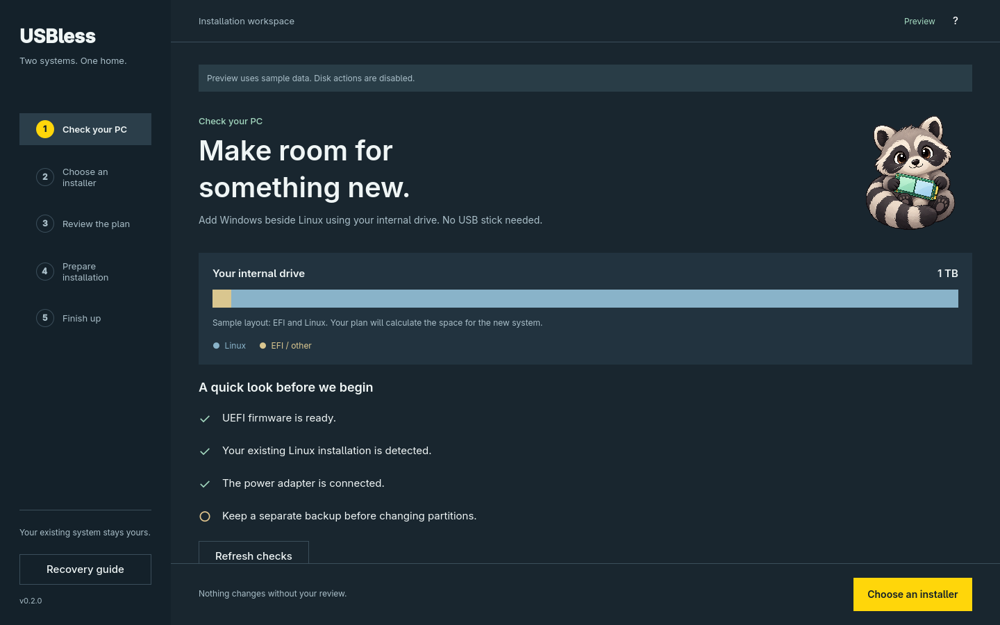

# usbless-dualboot

<p align="center"></p>

[](https://github.com/cYoren/usbless-dualboot/actions/workflows/ci.yml)
[](LICENSE)

**Install Windows alongside Linux — without a USB stick.**

`usbless-dualboot` turns the machine's own internal SSD into a temporary Windows installer, installs Windows into space you free up, and restores a clean dual-boot menu — with your Linux install still the default. No flash drive, no second computer, no guesswork about device names.

> Keywords: dual boot without USB · install Windows from internal SSD · Windows alongside Linux · LUKS/Btrfs shrink · Limine · GRUB · systemd-boot · Secure Boot (sbctl) · wimlib install.wim split

## Why

Installing Windows next to Linux normally needs a bootable USB. On modern laptops that is annoying (dongles, no spare stick, USB-C-only), and the risky part is never the copy — it is shrinking an encrypted filesystem and editing the partition table without destroying Linux. This project makes that path explicit, guarded, and repeatable.

## How it works

```
Linux (existing partitions)
├── EFI system partition
└── root (optionally LUKS + Btrfs/ext4)      ← shrink in place
        ↓ free space
┌───────────────────────────────┐
│  ~12 GiB FAT32 installer      │  ← ISO contents + split install.wim
├───────────────────────────────┤
│  ~150–300 GiB for Windows     │  ← Windows Setup installs here
└───────────────────────────────┘
        ↓
boot the internal installer → install Windows → restore boot menu
```

Microsoft's UEFI install media is just a FAT32 volume; the only wrinkle is that `sources/install.wim` can exceed FAT32's 4 GiB limit, which `wimlib`'s `wimsplit` solves (`install.swm`, `install2.swm`, …). Windows Setup accepts the split set automatically.

## Directions

The tool is organized around which OS you already have and which one you are adding:

| Direction | Status |
|---|---|
| `add-windows` — Linux machine gains Windows | Implemented, proven |
| `add-linux` — a machine gains Linux (GRUB loopback from internal disk) | Beta, distro-dependent (see `docs/DIRECTIONS.md`) |

## Requirements

- Linux booted in UEFI mode with a GPT disk.
- Free space **inside** the Linux filesystem (Btrfs or ext4), or willingness to shrink it.
- A Windows 11 ISO (official).
- Tools: `parted`/`sfdisk`, `wimlib`, `dosfstools`, `rsync`, plus `cryptsetup`/`btrfs-progs` when encrypted.

## Graphical app

The native Linux app walks through PC checks, ISO selection, plan review, preparation,
and finishing after installation. It includes English/Portuguese, the raccoon mascot,
live desktop accent colors, keyboard navigation and layouts for narrow windows.

```bash
./bin/build-ui
./build/usbless
```

Use `./build/usbless --demo` for a safe preview with sample storage and disk actions disabled.
On Arch/Omarchy, `./bin/install-ui` builds the package and adds **USBless Dualboot** to the
launcher. Passwords are entered in a separate visible terminal. See [GUI guide](docs/GUI.md),
[tablet preview](docs/screenshots/tablet.png) and [narrow-window preview](docs/screenshots/phone.png).

## Quickstart

```bash
# 1. See exactly what you have (read-only)
sudo ./bin/usbless-dualboot probe

# 2. Review a concrete plan and save it as this tool's config
sudo ./bin/usbless-dualboot plan --iso "$HOME/Downloads/Win11.iso" --linux-new-size 1526G --write

# 3. Free space (guarded; may ask you to reboot)
sudo ./bin/usbless-dualboot shrink

# 4. Build the internal installer partition
sudo ./bin/usbless-dualboot stage

# 5. Register a one-time UEFI boot entry, then reboot and pick it
sudo ./bin/usbless-dualboot boot --installer

# 6. Install Windows to the unallocated space, reboot back to Linux, then:
sudo ./bin/usbless-dualboot boot --restore
sudo ./bin/usbless-dualboot windows --add
sudo ./bin/usbless-dualboot secureboot --prep    # sign the Linux boot chain
# ... clear the Platform Key in firmware, reboot ...
sudo ./bin/usbless-dualboot secureboot --enroll  # keep Microsoft keys
# ... enable Secure Boot in firmware, reboot ...
sudo ./bin/usbless-dualboot secureboot --verify
```

## Commands

| Command | Purpose |
|---|---|
| `probe` | Detect disks, partitions, filesystems, encryption, bootloader, firmware, Secure Boot, TPM. `--json`. |
| `doctor` | Read-only readiness checks with blockers and next actions. `--json`; nonzero if blocked. |
| `verify` | Fingerprint a local ISO, or verify it against a publisher's SHA-256. `--json`. |
| `plan` | Print the exact shrink/partition plan. Changes nothing. |
| `status` | Read saved progress, interrupted phase, backup location and next step. `--json`. |
| `guide` | Installer choices tied to the saved disk and sector ranges; recovery guidance. |
| `shrink` | Back up GPT + LUKS header, scrub, shrink filesystem → LUKS → partition. |
| `stage` | Create the FAT32 installer partition, copy the ISO, split `install.wim`. |
| `boot` | Register a one-time UEFI entry; restore the default boot order later. |
| `windows` | Add/remove a Windows entry in the boot menu. |
| `secureboot` | `--prep` / `--enroll` / `--verify`: sign the Linux boot chain (sbctl) and enroll keys. |

Options are command-specific: use `<command> --help`. All mutating phases have `--dry-run`.
`--yes` and a global `--json` are not implemented. `boot --cancel` clears a pending BootNext
without deleting boot entries or partitions.

## Verify, inspect, then act

```bash
./bin/usbless-dualboot verify --iso ~/Downloads/Win11.iso
./bin/usbless-dualboot probe --json
./bin/usbless-dualboot doctor --json
./bin/usbless-dualboot status --json
```

To verify authenticity, add `--sha256` with the 64-character hash from the OS publisher,
either to `verify` or `plan`. Without a publisher hash, the tool saves a fingerprint to
detect later changes; it does **not** claim the download is authentic.

Save a plan to a single explicit path so ordinary and privileged commands use the same file:

```bash
sudo ./bin/usbless-dualboot plan --iso "$HOME/Downloads/Win11.iso" --linux-new-size 1526G --write
sudo ./bin/usbless-dualboot doctor
sudo ./bin/usbless-dualboot shrink --dry-run
# Review and confirm the plan before running shrink without --dry-run.
```

The size is an example, not a recommendation for your disk. A normal-user `plan --write`
saves `./usbless-dualboot.json`; later commands need that same path through `USBDB_CONFIG`.
For example, `sudo env USBDB_CONFIG="$PWD/usbless-dualboot.json" ./bin/usbless-dualboot status`.
Use `guide` before rebooting into the installer and `status` after returning to Linux.
No command automatically reboots the computer.

## Supported

| Area | Supported |
|---|---|
| Firmware | UEFI (GPT). BIOS is out of scope. |
| Filesystems | Single-device Btrfs online shrink, optionally LUKS. ext4 is detected but automatic offline shrink is not implemented. |
| Bootloaders | Limine, GRUB, systemd-boot (menu entry + ordering) |
| Secure Boot | Custom keys via `sbctl`; keeps Microsoft keys so Windows still boots |
| Distros | Any Arch-based or mainstream distro; Debian/Fedora tool mapping documented in `docs/DESIGN.md` |

## Case studies

Real runs on real hardware live in [`docs/case-studies/`](docs/case-studies/). The first is a
Dell G15 running Omarchy + Limine + LUKS/Btrfs with Windows 11 added. Add yours with the
template.

## Safety

- Storage phases compare the planned disk GUID, capacity, Linux partition UUID and start. Staging refuses overlapping partitions.
- Shrink and stage save GPT backups and the LUKS header when encrypted. Backups and saved plans use private permissions.
- Shrinking is ordered filesystem → encryption mapping → partition, never the reverse.
- Completed shrink/stage phases refuse to repeat. An interrupted phase blocks further storage and boot changes until reviewed.
- Disabling Secure Boot can recover an unsigned-loader failure. It cannot repair damaged storage.

See `docs/SAFETY.md`.

## For AI agents

This repo is designed to be used by coding agents:

- `llms.txt` — one-file project brief and entry points.
- `SKILL.md` — an agent skill describing when and how to use the tool.
- `probe`, `doctor`, `verify`, `status` offer JSON; mutating phases offer `--dry-run`.

An agent should always run `probe` and `plan` first, show the user the plan, and only then run `shrink`.

## Status

Version 0.2 adds a native graphical app, readiness checks, SHA-256 verification, progress reporting, installer
instructions, interrupted-phase protection, GPT identity checks and one-time boot recovery.
`make test` runs host smoke checks and isolated regressions with mocked firmware/privilege
handoff. `make test-ui` compiles Qt tests and drives the actual interface offscreen. Tests
never partition a real disk or write firmware variables.

The original Windows-on-Linux procedure has a real hardware case study. The generalized
phases changed since that run and still need disposable VM and hardware validation.
Linux ISO loopback staging remains beta. The Windows-native application now builds locally;
its installation matrix is under validation. Automatic downloads, storage placement and
cleanup are being integrated across platforms. Linux ext4 shrink and broader installation
coverage remain in development. See [coverage and validation](docs/COVERAGE.md) for evidence.

## Recovery and licensing

See [recovery](docs/RECOVERY.md), [security reporting](SECURITY.md), and
[third-party licenses](THIRD_PARTY_NOTICES.md). The application and its build/test tools
are open-source. Windows media remains separately licensed and is not redistributed.

## Contributing

See [`CONTRIBUTING.md`](CONTRIBUTING.md). Good first issues are labeled and there is a
[case-study template](docs/case-studies/TEMPLATE.md).

## License

MIT — see `LICENSE`.
